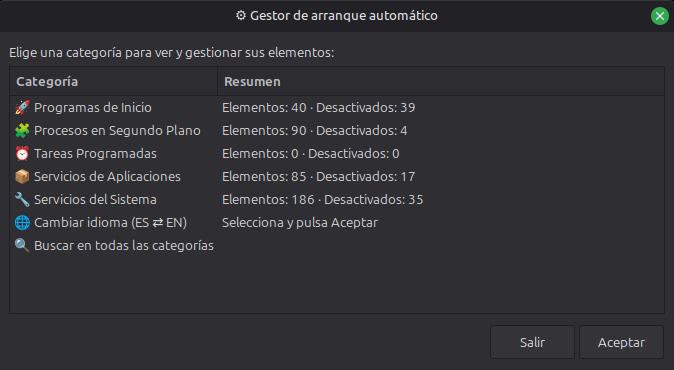
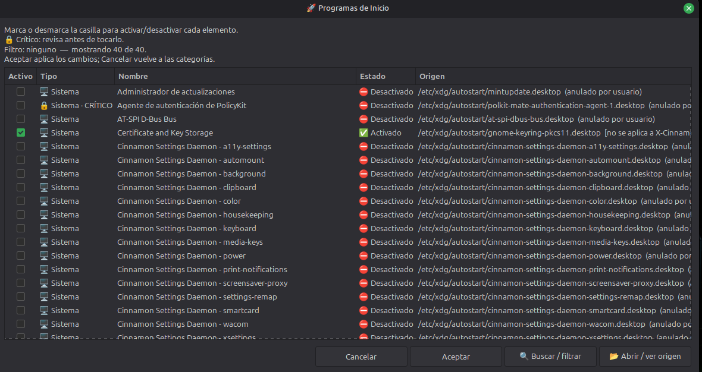
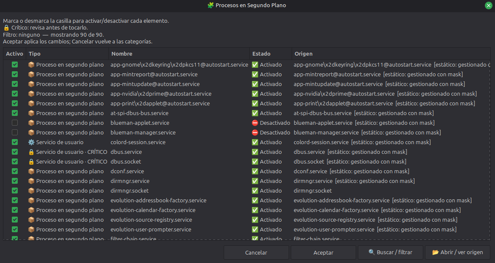
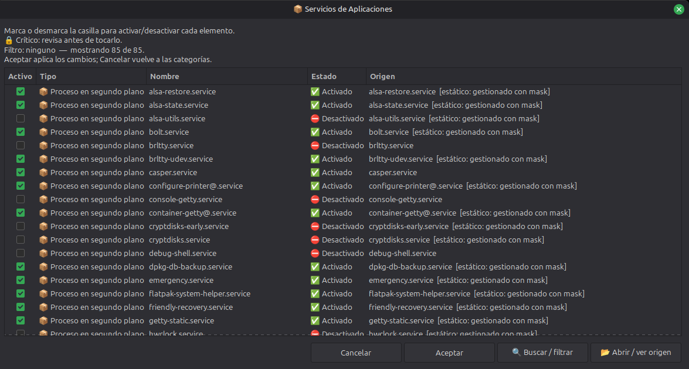
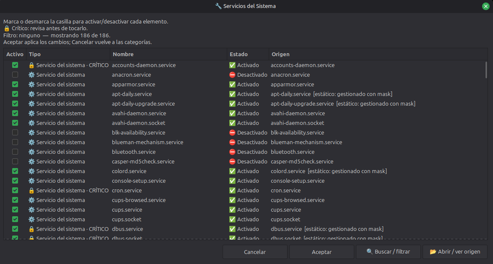
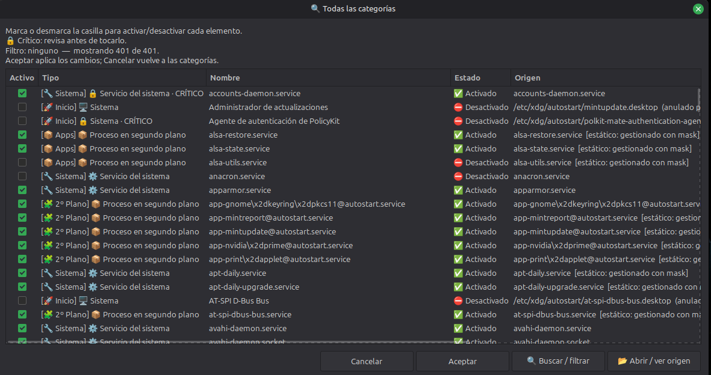

<p align="center">
  
</p>

<h1 align="center">Autostart Manager</h1>

<p align="center">
  Todo lo que se inicia con tu sesión de Linux en un solo panel: aplicaciones de autostart, servicios systemd y tareas cron.<br>
  Búscalo, actívalo o desactívalo, y recibe un aviso antes de desactivar algo crítico.
</p>

<p align="center"><strong><a href="README.md">Read in English</a></strong></p>









*Actualización 22-10-2026 (versión 2.2.0). Novedades:*
- **Instalar y desinstalar sin root**: `--install` deja el programa, un lanzador de menú y su icono en tus carpetas de usuario; `--uninstall` quita exactamente eso y nada más.
- **Cualquier escritorio Linux**: la interfaz ya no nombra ninguna distribución. Si falta `zenity` o `pkexec`, te dice el comando de instalación de tu gestor de paquetes (`apt`, `dnf`, `pacman`, `zypper`...).
- **Diálogos arreglados en Zenity 3.44**: esa versión rechazaba una opción que usaba el programa, y las confirmaciones y los resultados caían a una ventana básica. Ahora todos los diálogos tienen su título, tamaño y botones en Zenity 3.44 y 4.x.
- **El editor de tu escritorio** abre primero los archivos de origen (`xed`, `gnome-text-editor`, `kate`, `mousepad`, `pluma`...).
- **Cambios más seguros**: el autostart del sistema sigue la prioridad de `XDG_CONFIG_DIRS`, los archivos se escriben de forma atómica y los `.desktop` mal formados se rechazan en lugar de modificarse.

## El problema que resuelve

Lo que se inicia con tu sesión vive en cinco sitios distintos: los `.desktop` de autostart (los tuyos y los del sistema), los servicios `systemd` de tu usuario y de toda la máquina, y tu tabla de `cron`. Cada uno tiene su carpeta, sus comandos y su forma de desactivarse, y ninguna herramienta los muestra juntos.

Autostart Manager los lista todos en una sola tabla buscable y te deja activarlos o desactivarlos desde ahí, sin buscar el archivo ni acordarte del comando. Es un único archivo `.sh`; la única dependencia obligatoria es `zenity`.

## Qué hace exactamente

**Autostart Manager 2.2.0** es un gestor gráfico escrito en Bash + Zenity. Lee cinco fuentes:

1. Aplicaciones de autostart del usuario en `$XDG_CONFIG_HOME/autostart` (normalmente `~/.config/autostart`).
2. Aplicaciones de autostart del sistema en `$XDG_CONFIG_DIRS/autostart` (normalmente `/etc/xdg/autostart`).
3. Servicios y sockets de `systemd` del usuario.
4. Servicios y sockets de `systemd` de todo el sistema.
5. Las tareas de `crontab` del usuario actual.

- **Muestra qué es cada elemento**: tipo, nombre, estado y origen, agrupados en cinco categorías (Programas de Inicio, Procesos en Segundo Plano, Tareas Programadas, Servicios de Aplicaciones y Servicios del Sistema) o todos a la vez con **Buscar en todas las categorías**.
- **Activa y desactiva por lotes**: marcas o desmarcas lo que quieras, aplicas una vez y lees un resumen donde cada fallo se informa por separado.
- **Protege lo importante**: los servicios y agentes críticos piden una confirmación aparte antes de desactivarse.
- **No toca los archivos del sistema**: una entrada de autostart del sistema se desactiva con una anulación en tu carpeta de usuario; el archivo original nunca se reescribe.
- **Te pide la contraseña una sola vez**: los cambios en servicios del sistema se agrupan en una sola autenticación con `pkexec` cuando es posible.
- **Escribe con seguridad**: los archivos se reemplazan de forma atómica, una edición externa hecha mientras el programa estaba abierto se detecta en lugar de sobrescribirse y los enlaces simbólicos se rechazan.
- **Respeta tu escritorio**: muestra `OnlyShowIn=` y `NotShowIn=` cuando una entrada no se aplica a tu escritorio y usa los nombres localizados (`Name[...]`).
- **Abre el origen**: el `.desktop` o el archivo de unidad se abre en tu editor para inspeccionarlo; con cron te indica que uses `crontab -e`.
- **Avisa si lo ejecutas como root**: gestionaría el autostart y el cron de root, no los de tu usuario normal.
- **Se adapta sin quejarse**: sin `systemd` o sin `crontab`, esas secciones simplemente salen vacías.

Cómo se usa:

1. Ábrelo y elige una categoría, o **Buscar en todas las categorías**.
2. Marca o desmarca los elementos que quieras cambiar; cada fila muestra su tipo, estado y origen.
3. Pulsa **Aceptar** para aplicar el lote. Si hay un servicio crítico, lo revisas antes.
4. Lee el resumen. Usa **Abrir / ver origen** cuando quieras ver el archivo que hay detrás de una entrada.

Una limitación de Zenity: al reconstruir una lista filtrada se pierden los cambios de casillas que aún no has aplicado.

## Instalación

Ejecútalo directamente desde el repositorio, sin instalar nada:

```bash
git clone https://github.com/filonux/Autostart_Manager.git
cd Autostart_Manager
chmod +x script/Autostart_Manager.sh
./script/Autostart_Manager.sh
```

Para instalarlo para tu usuario (sin root):

```bash
./script/Autostart_Manager.sh --install
```

Esto copia el programa a `~/.local/bin/autostart-manager`, añade un lanzador con su icono al menú de aplicaciones y anota cada archivo (ruta y SHA-256) en `~/.local/share/autostart-manager/install.manifest`. Si lo repites, actualiza la instalación, y un archivo que no instaló él nunca se sobrescribe. Si `~/.local/bin` no está en tu `PATH`, el lanzador funciona igual; añade el directorio para ejecutar `autostart-manager` desde una terminal. Las rutas siguen `XDG_DATA_HOME` cuando es absoluta, así que desinstala con el mismo valor.

Para quitarlo:

```bash
./script/Autostart_Manager.sh --uninstall
```

También funciona desde la copia instalada (`autostart-manager --uninstall`). Borra exactamente lo que lista el manifiesto y los directorios que creó, si están vacíos. Un archivo que modificaste después de instalar se conserva y se avisa (`--purge` lo borra igualmente). También pregunta si quieres borrar la copia del crontab que el programa guarda en `~/.local/state/autostart-manager/` (`--keep-config` la conserva, `--purge` la borra; sin terminal para responder, se conserva).

Desinstalar **no** deshace los cambios que hiciste en tus entradas de arranque: pertenecen al autostart, a systemd y a cron, y quedan como los dejaste.

## Scriptya

[Scriptya](https://github.com/filonux/Scriptya) es mi gestor de scripts: un menú para tus scripts que además convierte cualquiera de ellos en una app de escritorio con su propio icono. Autostart Manager no lo necesita, pero encajan, porque el script empieza con la cabecera `MENU`, `DESCRIPTION` e `ICON` de Scriptya:

- **Ejecutarlo**: pon `script/Autostart_Manager.sh` en la carpeta que gestiona Scriptya y aparece en el menú como «Autostart Manager», con su descripción.
- **Instalarlo como app**: con **Instalar Scripts**, Scriptya añade una entrada de menú (y un acceso en el Escritorio si quieres) que ejecuta el script donde está, y te ofrece el icono del proyecto que indica la cabecera. `icon1.png` a `icon4.png`, en `assets/`, son alternativas: rechaza el icono de la cabecera y busca el que prefieras.
- **Cambiarle el icono o desinstalarlo**: ambas cosas desde el propio menú de Scriptya.
- **Elige una sola vía**: usa la instalación de Scriptya o `--install`, no las dos, o tendrás dos entradas en el menú.

## Comandos

| Comando | Qué hace |
|---|---|
| `./script/Autostart_Manager.sh` | Abre el gestor gráfico |
| `./script/Autostart_Manager.sh --help` | Muestra la ayuda |
| `./script/Autostart_Manager.sh --version` | Muestra la versión |
| `./script/Autostart_Manager.sh -l` | Arranca en el otro idioma (español ⇄ inglés) |
| `./script/Autostart_Manager.sh --toggle-language` | Igual que `-l` |
| `./script/Autostart_Manager.sh --lang en` | Fuerza inglés en esa ejecución |
| `./script/Autostart_Manager.sh --lang es` | Fuerza español en esa ejecución |
| `./script/Autostart_Manager.sh --install` | Instala para tu usuario |
| `./script/Autostart_Manager.sh --uninstall` | Quita lo que puso `--install` |
| `./script/Autostart_Manager.sh --uninstall --keep-config` | Igual, conservando la copia del crontab sin preguntar |
| `./script/Autostart_Manager.sh --uninstall --purge` | Igual, borrando también lo modificado y la copia |

`--install` y `--uninstall` se ejecutan en la terminal, sin Zenity, y se niegan a funcionar como root. Pon `--lang` antes de ellos (`--lang es --install`).

Sigue las ubicaciones XDG (`XDG_CONFIG_HOME`, `XDG_CONFIG_DIRS` donde manda la primera coincidencia, y `XDG_STATE_HOME` para la copia); deben ser rutas absolutas. Dos variables son tuyas para configurar:

| Variable | Significado | Por defecto |
|---|---|---|
| `AUTOSTART_MANAGER_LANG` | Idioma inicial de la interfaz: `en` o `es` | Detectado desde tu locale |
| `AUTOSTART_MANAGER_LOCK_TIMEOUT` | Segundos de espera del bloqueo por usuario | `10` |

## Compatibilidad

Funciona en cualquier escritorio Linux que siga la especificación XDG de autostart:

| Componente | Requisito |
|---|---|
| `bash` | 4.4 o superior (probado con 4.4.18, 5.0, 5.1, 5.2 y 5.3) |
| `zenity` | 3.44 (GTK 3) o 4.x (GTK 4); probado con 3.44.2 y 4.0.1 |
| `systemd`, `crontab` | Opcionales; sus secciones se omiten si no están |
| `pkexec` | Solo para servicios del sistema (ver abajo) |
| Editor de texto | El nativo de tu escritorio, luego `gedit`, `kwrite`, `geany` y otros; `xdg-open` solo para abrir sin privilegios |

`pkexec` solo es necesario para operaciones que requieran privilegios de administrador; un agente gráfico de PolicyKit es necesario para mostrar un diálogo gráfico de contraseña, y si no hay, `pkexec` puede recurrir a un agente textual. Editar con privilegios exige un editor soportado de confianza.

El programa solo usa opciones de Zenity que aceptan ambas versiones, y lee la versión de Zenity al arrancar para dimensionar sus listas. Se ha probado en Ubuntu 24.04, con los diálogos reales y en CI, y todavía no en otras distribuciones. Límites conocidos: `pkexec` y `systemctl` solo se buscan en rutas estándar del sistema (NixOS no está soportado), la interfaz usa emojis (instala una fuente de emojis si se ven como cuadros) y la edición gráfica con privilegios necesita X11 o XWayland.

## Idioma

La interfaz está en español e inglés. Al arrancar mira `LC_ALL`, luego `LC_MESSAGES` y luego `LANG`: un locale español da español y cualquier otro da inglés. La elección no se guarda: fíjala en una ejecución con `--lang en|es`, `-l` / `--toggle-language` (el contrario del detectado) o `AUTOSTART_MANAGER_LANG`, y cámbiala en cualquier momento con la fila de idioma del menú. El script nunca modifica el locale de tu sistema.

El README en inglés es [README.md](README.md).

## Contribuir

Lee [`.github/CONTRIBUTING.md`](.github/CONTRIBUTING.md) antes de cambiar código: explica cómo ejecutar la suite de pruebas (`tests/run_all.sh`) y el lint. Mantén un cambio lógico por pull request, actualiza la documentación cuando cambie el comportamiento e incluye tus resultados de pruebas. Para errores e ideas usa las plantillas del repositorio; para problemas de seguridad sigue [`.github/SECURITY.md`](.github/SECURITY.md) en lugar de abrir una incidencia pública.

## Licencia

Distribuido bajo la **GNU General Public License v3.0 (GPLv3)**. Consulta [`LICENSE.txt`](LICENSE.txt).

Hecho por **[Filonux](https://github.com/filonux)**.
