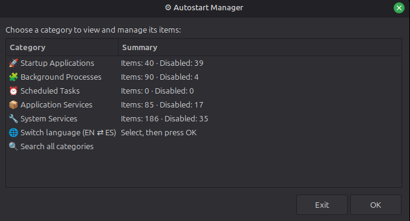
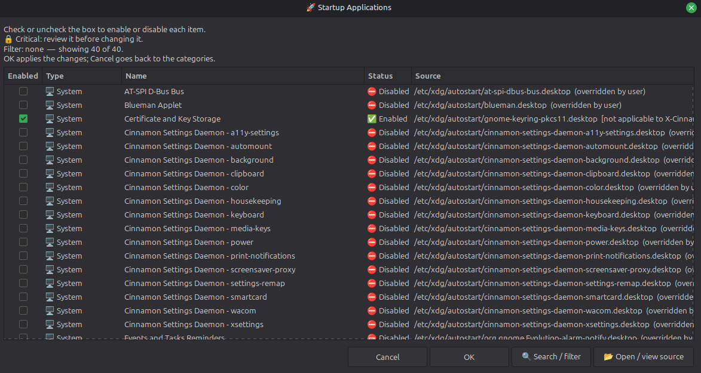
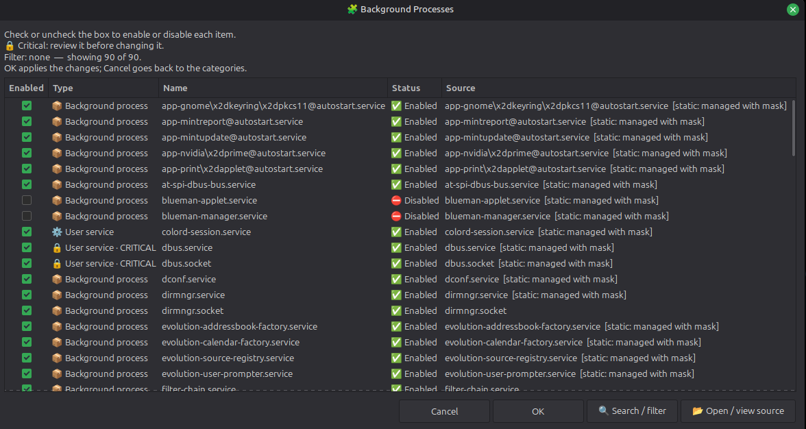
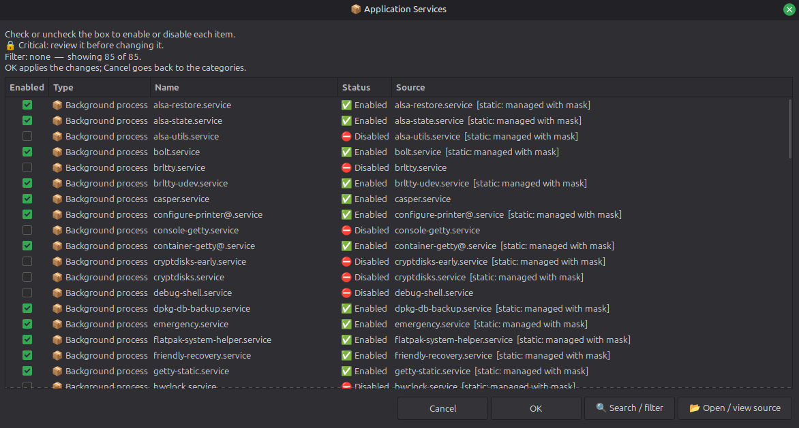
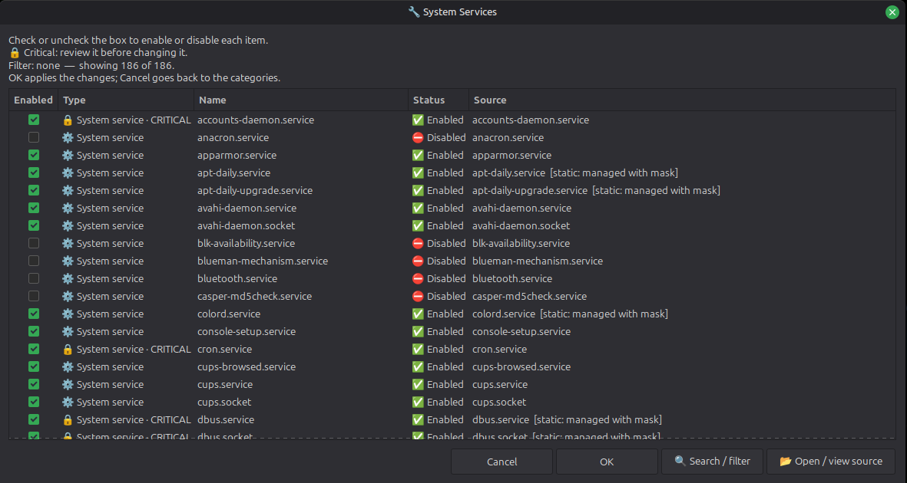
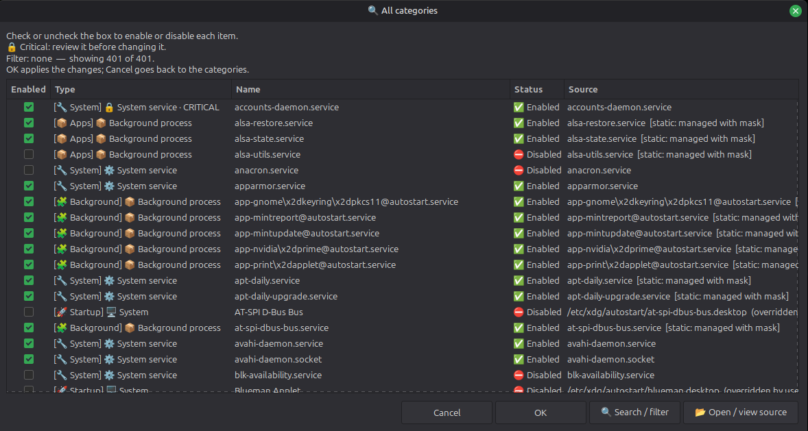

<p align="center">
  
</p>

<h1 align="center">Autostart Manager</h1>

<p align="center">
  Everything that starts with your Linux session in one panel: autostart apps, systemd services and cron tasks.<br>
  Search it, switch it on or off, and get a warning before you disable something critical.
</p>

<p align="center"><strong><a href="README.es.md">Leer en español</a></strong></p>









*Update 22-10-2026 (version 2.2.0). What's new:*
- **Install and uninstall without root**: `--install` puts the program, a menu launcher and its icon in your user directories; `--uninstall` removes exactly that and nothing else.
- **Any Linux desktop**: the interface no longer names a distribution. A missing `zenity` or `pkexec` is reported with the install command of your package manager (`apt`, `dnf`, `pacman`, `zypper`...).
- **Dialogs fixed on Zenity 3.44**: that version rejected an option the program used, so confirmations and results fell back to a bare window. Now every dialog has its title, size and buttons on Zenity 3.44 and 4.x.
- **Your desktop's own editor** opens the source files first (`xed`, `gnome-text-editor`, `kate`, `mousepad`, `pluma`...).
- **Safer changes**: system autostart follows the `XDG_CONFIG_DIRS` priority, files are written atomically and malformed `.desktop` files are rejected instead of modified.

## The problem it solves

What starts with your session lives in five different places: autostart `.desktop` files (yours and the system's), `systemd` services for your user and for the whole machine, and your `cron` table. Each one has its own folder, its own commands and its own way of being disabled, and no tool shows them together.

Autostart Manager lists them all in one searchable table and lets you enable or disable them from there, without hunting for the file or remembering the command. It is a single `.sh` file; the only mandatory dependency is `zenity`.

## What it does

**Autostart Manager 2.2.0** is a graphical manager written in Bash + Zenity. It reads five sources:

1. User autostart applications from `$XDG_CONFIG_HOME/autostart` (normally `~/.config/autostart`).
2. System autostart applications from `$XDG_CONFIG_DIRS/autostart` (normally `/etc/xdg/autostart`).
3. Per-user `systemd` services and sockets.
4. System-wide `systemd` services and sockets.
5. The current user's `crontab` tasks.

- **Shows what each entry is**: type, name, state and source, grouped in five categories (Startup Applications, Background Processes, Scheduled Tasks, Application Services and System Services) or all at once with **Search all categories**.
- **Enables and disables in batches**: you check or uncheck what you want, apply once and read a summary where every failure is reported on its own.
- **Protects what matters**: critical services and agents need a separate confirmation before they are disabled.
- **Leaves system files alone**: a system autostart entry is disabled through an override in your user directory; the original file is never rewritten.
- **Asks for your password once**: the changes to system services are grouped into one `pkexec` authentication where possible.
- **Writes safely**: files are replaced atomically, an external edit made while the program was open is detected instead of overwritten, and symlinks are refused.
- **Respects your desktop**: `OnlyShowIn=` and `NotShowIn=` are shown when an entry doesn't apply to your desktop, and localized names (`Name[...]`) are used.
- **Opens the source**: the `.desktop` or unit file opens in your editor for inspection; for cron it tells you to use `crontab -e`.
- **Warns if you run it as root**: it would manage root's autostart and cron, not those of your normal user.
- **Degrades quietly**: without `systemd` or `crontab` those sections are simply empty.

How you use it:

1. Open it and choose a category, or **Search all categories**.
2. Check or uncheck the entries you want to change; each row shows its type, state and source.
3. Press **OK** to apply the batch. If a critical service is in it, you review it first.
4. Read the summary. Use **Open / view source** when you want to see the file behind an entry.

One Zenity limitation: rebuilding a filtered list discards the checkbox changes you haven't applied yet.

## Installation

Run it straight from the repository, no installation needed:

```bash
git clone https://github.com/filonux/Autostart_Manager.git
cd Autostart_Manager
chmod +x script/Autostart_Manager.sh
./script/Autostart_Manager.sh
```

To install it for your user (no root):

```bash
./script/Autostart_Manager.sh --install
```

This copies the program to `~/.local/bin/autostart-manager`, adds a launcher with its icon to your applications menu and records every file (path and SHA-256) in `~/.local/share/autostart-manager/install.manifest`. Running it again updates the installation, and a file it did not install is never overwritten. If `~/.local/bin` is not in your `PATH` the launcher still works; add the directory to run `autostart-manager` from a terminal. The paths follow `XDG_DATA_HOME` when it is absolute, so uninstall with the same value.

To remove it:

```bash
./script/Autostart_Manager.sh --uninstall
```

It also works from the installed copy (`autostart-manager --uninstall`). It deletes exactly what the manifest lists and the directories it created, if they are empty. A file you modified after installing is kept and reported (`--purge` deletes it anyway). It also asks whether to delete the crontab backup the program keeps in `~/.local/state/autostart-manager/` (`--keep-config` keeps it, `--purge` deletes it; with no terminal to answer, it is kept).

Uninstalling does **not** undo the changes you made to your startup entries: those belong to autostart, systemd and cron and stay as you left them.

## Scriptya

[Scriptya](https://github.com/filonux/Scriptya) is my script manager: a menu for your scripts that also turns any of them into a desktop app with its own icon. Autostart Manager does not need it, but they fit together, because the script starts with Scriptya's `MENU`, `DESCRIPTION` and `ICON` header:

- **Run it**: put `script/Autostart_Manager.sh` in the folder Scriptya manages and it shows up in the menu as "Autostart Manager", with its description.
- **Install it as an app**: with **Install Scripts**, Scriptya adds a menu entry (and a desktop shortcut if you want) that runs the script where it is, and offers the project icon from the header. `icon1.png` to `icon4.png` in `assets/` are alternatives: decline the header icon and browse to the one you prefer.
- **Change the icon or uninstall it**: both from Scriptya's own menu.
- **Pick one way**: use Scriptya's install or `--install`, not both, or you will get two entries in your menu.

## Commands

| Command | What it does |
|---|---|
| `./script/Autostart_Manager.sh` | Opens the graphical manager |
| `./script/Autostart_Manager.sh --help` | Shows the help |
| `./script/Autostart_Manager.sh --version` | Shows the version |
| `./script/Autostart_Manager.sh -l` | Starts in the other language (English ⇄ Spanish) |
| `./script/Autostart_Manager.sh --toggle-language` | Same as `-l` |
| `./script/Autostart_Manager.sh --lang en` | Forces English for that run |
| `./script/Autostart_Manager.sh --lang es` | Forces Spanish for that run |
| `./script/Autostart_Manager.sh --install` | Installs for your user |
| `./script/Autostart_Manager.sh --uninstall` | Removes what `--install` put in place |
| `./script/Autostart_Manager.sh --uninstall --keep-config` | Same, keeping the crontab backup without asking |
| `./script/Autostart_Manager.sh --uninstall --purge` | Same, also deleting modified files and the backup |

`--install` and `--uninstall` run in the terminal, without Zenity, and refuse to run as root. Put `--lang` before them (`--lang es --install`).

It follows the XDG locations (`XDG_CONFIG_HOME`, `XDG_CONFIG_DIRS` where the first match wins, and `XDG_STATE_HOME` for the backup); they must be absolute paths. Two variables are yours to set:

| Variable | Meaning | Default |
|---|---|---|
| `AUTOSTART_MANAGER_LANG` | Initial interface language: `en` or `es` | Detected from your locale |
| `AUTOSTART_MANAGER_LOCK_TIMEOUT` | Seconds to wait for the per-user lock | `10` |

## Compatibility

It runs on any Linux desktop that follows the XDG autostart specification:

| Component | Requirement |
|---|---|
| `bash` | 4.4 or newer (tested with 4.4.18, 5.0, 5.1, 5.2 and 5.3) |
| `zenity` | 3.44 (GTK 3) or 4.x (GTK 4); tested with 3.44.2 and 4.0.1 |
| `systemd`, `crontab` | Optional; their sections are omitted when unavailable |
| `pkexec` | Only for system services (see below) |
| Text editor | The native one of your desktop, then `gedit`, `kwrite`, `geany` and others; `xdg-open` only for unprivileged opening |

`pkexec` is required only for operations that need administrator privileges; a graphical PolicyKit authentication agent is needed for a graphical password prompt, otherwise `pkexec` may fall back to a text agent. Privileged editing requires a trusted supported editor.

The program only uses Zenity options that both versions accept, and reads the Zenity version at start to size its lists. It has been tested on Ubuntu 24.04, in the real dialogs and under CI, and not yet on other distributions. Known limits: `pkexec` and `systemctl` are only looked up in standard system paths (NixOS is not supported), the interface uses emoji (install an emoji font if they show as boxes), and graphical editing with elevated privileges needs X11 or XWayland.

## Language

The interface is available in English and Spanish. On start it checks `LC_ALL`, then `LC_MESSAGES`, then `LANG`: a Spanish locale gives Spanish and any other gives English. The choice is not saved: set it for a run with `--lang en|es`, `-l` / `--toggle-language` (the opposite of the detected one) or `AUTOSTART_MANAGER_LANG`, and switch it at any moment with the language row of the menu. The script never modifies your system locale.

The Spanish README is [README.es.md](README.es.md).

## Contributing

Read [`.github/CONTRIBUTING.md`](.github/CONTRIBUTING.md) before changing code: it explains how to run the test suite (`tests/run_all.sh`) and the lint. Keep one logical change per pull request, update the documentation when behaviour changes and include your test results. For bugs and ideas use the repository templates; for security problems follow [`.github/SECURITY.md`](.github/SECURITY.md) instead of opening a public issue.

## License

Distributed under the **GNU General Public License v3.0 (GPLv3)**. See [`LICENSE.txt`](LICENSE.txt).

Made by **[Filonux](https://github.com/filonux)**.
